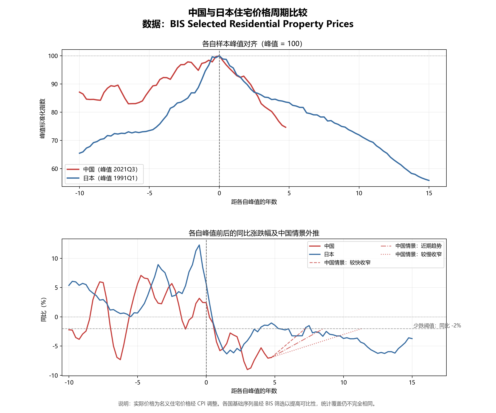

# 中国房地产调整与日本九十年代房地产泡沫破裂有多相似

## 核心问题

网上常把中国自 2021 年前后开始的房地产调整类比为日本 1990 年代房地产泡沫破裂。这个类比在哪些机制上有证据支持，哪些地方会误导？它能否用于预测中国房价、经济增长或调整时长？

这里暂把“类似”拆成四层：

1. **现象类似**：房价、成交、投资和信贷是否都由盛转衰；
2. **成因类似**：是否同由资产高估、信用扩张、人口转折和政策收紧触发；
3. **传导类似**：是否都通过财富效应、资产负债表收缩、银行坏账和总需求不足影响经济；
4. **路径类似**：跌幅、持续时间、政策反应和最终结果是否可以互相预测。

前两三层可以部分成立，不等于第四层成立。

## 当前判断

**中日具有重要的结构性相似之处，但“中国将机械复制日本九十年代路径”的证据不足。**

- 对“房地产繁荣结束后会长期拖累内需”的判断，信心为**中高**；
- 对“存在资产负债表调整和通缩压力”的判断，信心为**中**；
- 对“中国已处在日本某个精确年份、未来将按相同年数运行”的判断，信心为**低**。

日本经验更适合作为风险机制和政策失误的参照，不适合作为单一路径预测模型。

## 支持类比的证据

### BIS 实际住宅价格走势图



图表采用 BIS “精选住宅价格”季度数据中的实际价格指数（名义房价经 CPI 调整）。脚本按各自完整样本的最高点自动对齐：日本峰值为 1991 年一季度，中国峰值为 2021 年三季度。截至 BIS 当前最新观测，中国实际住宅价格较峰值下降约 25.3%；日本在峰值后约五年时下降约 17%，中国同期约下降 25%，显示中国调整初期更陡。但中国峰值后数据仅约五年，不能据此外推日本随后十余年的轨迹。

日本在峰值后第 4 年（1995 年前后）第一次进入同比跌幅约 1%—2% 的“少跌阶段”，但此后又有下行，并非永久见底。按“同比跌幅不超过 2%，并连续维持八个季度”的严格口径，日本直到 2009 年三季度才稳定满足，距峰值约 18.5 年。也就是说，日本是“约四年结束第一轮急跌，约十八至十九年才进入较稳定平台”。

中国在峰值后约 4.75 年仍同比下跌约 7%，尚未进入日本第 4—5 年时的少跌状态。若仅将 2024 年三季度约 -9% 到 2026 年二季度约 -7% 的改善速度作线性情景外推：

- 跌幅每年收窄 2 个百分点：约 2028 年末进入同比跌幅 2% 以内；
- 按近期拟合速度每年收窄约 1.3 个百分点：约 2030 年进入；
- 每年仅收窄 0.75 个百分点：约 2033 年进入。

因此，现阶段更审慎的预测是：中国可能还需要约 **3—7 年**才首次进入“同比少跌”区间，即大致在 **2029—2033 年**；若要求连续八个季度确认稳定，则相应约为 **2031—2035 年**。这只是基于短序列的速率情景，不是因果模型，政策、通胀、城市分化和统计口径都足以显著改变结果。

可复现文件：[绘图脚本](../scripts/plot-china-japan-house-prices.py) · [清洗后数据](../data/china-japan-house-prices.csv)

### 1. 房地产和信用在繁荣期形成正反馈，转折后又形成负反馈

两国都出现过：

```text
房价上涨预期 → 抵押品价值和融资增加 → 土地、住房与建设需求扩大
→ 房价进一步上涨

预期逆转 → 销售和信贷转弱 → 投资与收入下降 → 抵押品和财富缩水
→ 需求继续走弱
```

日本 1980 年代后半期经历股票、土地价格和信用共同繁荣；泡沫破裂后，土地价格长期下降，抵押品缩水损害银行和企业资产负债表。中国在 2015—2021 年间也经历房价和居民债务显著上升，2021 年后市场明显减速。国际清算银行的研究把中国当前风险明确描述为可能出现住房繁荣—萧条与债务通缩式循环。

### 2. 房地产在宏观经济中的体量都足以产生长期拖累

IMF 估计，中国房地产及相关活动一度占经济活动约 20%，另有研究估计 2021 年约为 25%（剔除进口投入约 22%）。高占比意味着即使没有银行危机，住宅建设回归较低水平也会拖慢投资、就业和地方财政。

截至 2025 年，中国调整仍在继续：国家统计局公布房地产开发投资同比下降 17.2%，新建商品房销售面积下降 8.7%，个人按揭贷款下降 17.8%，年末待售商品房面积增长 1.6%。这不是仅有价格波动，而是销售、投资、融资和库存共同调整。

### 3. 人口与住房需求的长期条件都在转弱

日本泡沫破裂后，劳动年龄人口转折和老龄化逐渐成为增长与住房需求的长期约束。中国也已进入总人口下降、家庭形成放慢和城市化速度下降的阶段。IMF 因而预计中国新增住房建设需求将在未来十年显著下降。

人口并不能单独解释泡沫何时破裂，但会降低调整后重新回到旧建设规模的可能性。

### 4. 都存在“价格下跌—财富缩水—消费偏弱”的渠道

中国家庭财富较多集中于住房，住房价格下跌会通过财富和信心影响消费。IMF 的跨国和中国省级证据显示，房地产下行与通胀回落相关，除投资直接下降外，家庭财富效应是重要渠道。这与日本资产价格下跌后私人部门趋向储蓄和修复资产负债表的现象有可比性。

### 5. 延缓确认损失可能拉长调整

日本银行不良贷款确认和处置迟缓，使信贷配置和企业重组长期受阻；全面银行危机在地产转折约六年后才显现。中国也存在开发商重组缓慢、贷款展期以及为保证预售住房交付而延后损失确认的问题。两者共同提示：稳定短期价格和避免集中违约可以降低即时冲击，但若没有可行主体退出、债务重组和损失分担，也可能延长低效状态。

## 限制类比的关键差异

| 维度 | 日本 1980 年代末—1990 年代 | 中国 2021 年后 | 对类比的含义 |
|---|---|---|---|
| 主要杠杆主体 | 企业和金融机构是核心，土地和股票抵押融资广泛 | 开发商、居民住房、地方土地财政及相关融资相互连接 | 中国不宜只用“居民提前还贷”解释 |
| 资产泡沫范围 | 商业地产、土地与股票同步形成巨大泡沫 | 住房和土地链条更突出，股票并未同步形成同规模泡沫 | 银行资本和财富效应的传导不同 |
| 住房制度 | 成熟市场，现房和企业融资问题突出 | 高度依赖预售，保交付和购房者债权具有特殊政治经济约束 | 中国的销售下降会直接切断开发商运营资金 |
| 地方财政 | 地方政府并未同等依赖土地出让收入 | 土地出让和房地产相关税费深嵌地方财政与基建模式 | 中国存在更强的财政—地产反馈 |
| 城市化与收入水平 | 已是高收入成熟经济体，城市化基本完成 | 仍有城市化和改善需求，但总人口下降、地区分化且存量已大 | 中国仍有局部需求，不能由全国人口机械推导 |
| 银行与资本账户 | 市场化金融体系，银行危机最终公开显现 | 国有银行占主导、资本管制更强、政府协调和展期能力更大 | 可压低挤兑风险，但损失不会因此消失，可能转为财政或长期低收益资产 |
| 外部环境 | 日元升值、贸易摩擦；后来受益于全球贸易扩张 | 制造业竞争力强，但面临更强的地缘政治与贸易约束 | 出口能否抵消内需收缩并不相同 |
| 政策触发 | 1989—1990 年连续加息和房地产贷款总量限制 | “三道红线”等开发商融资约束叠加疫情、预期转弱与结构性需求下降 | 都有政策收紧，但冲击对象和时序不同 |

## 最有力的替代解释

### 不是“日本化”，而是发展模式转换

中国房地产下行也可解释为：长期高建设率、棚改和城市扩张带来的需求逐步耗尽后，经济必须从土地融资和新建住房转向服务、消费、制造升级与存量更新。若其他产业能吸收资本和就业，房地产收缩不必产生日本式长期停滞。

### 日本的低增长不全是房地产造成的

日本 1990 年代的停滞与银行坏账、企业“债务—产能—就业”三重过剩密切相关；2000 年代增长偏低又更多受劳动人口下降影响。按人均或每名劳动者产出观察，日本的表现没有“失去二十年”这一标签暗示得那么差。因此，拿日本总量 GDP 路径直接预测中国，会混入人口和生产率差异。

### 中国的价格指数可能低估调整，但也不能把成交萎缩全算成价格崩盘

中国调整早期更多体现在销售、新开工和土地成交，而官方新房价格降幅相对有限；地方限价、城市样本、二手房和房屋质量变化都会影响观测。反过来，成交量下跌也不能自动等同于日本式全国土地价格长期跌幅。应分别比较实际房价、租售比、价格收入比、成交量和库存。

## 为什么“现在等于日本 199x 年”缺乏佐证

仅把房价见顶、居民贷款净增转负或某项投资见顶的年份对齐，隐含了两国债务主体、金融制度、政策反应和人口过程相同。这个前提并不成立。尤其是：

- 居民贷款余额变化是新发放、正常还款、提前还款、核销和统计调整的净结果；
- 单月、年内累计和完整年度数据不能混用；
- BIS household credit、人民银行住户贷款和住房按揭贷款并非同一口径；
- 周期转折的相似指标不能推出剩余周期时长相同。

因此，某一条重叠曲线可以说明“值得比较”，不能证明“中国领先或落后日本若干年”。

## 可检验的后续指标

若中国真正沿日本式资产负债表衰退发展，未来应同时观察到：

1. 私营企业和居民即使在低利率下仍持续压缩净债务；
2. 银行不良资产、展期和低效“僵尸”主体长期存在；
3. 房地产财富缩水持续压低消费和名义需求；
4. 财政扩张主要抵消私人部门储蓄，而难以恢复私人信用需求；
5. 名义增长、工资和物价长期偏弱。

反驳或削弱日本化判断的证据则包括：居民消费占比持续提高、开发商快速完成重组和退出、银行损失透明确认、地方财政摆脱土地依赖，以及非房地产部门形成足以吸收就业和资本的新需求。

## 用居民负债与租售比判断底部

### 对相似点和不同点的修正

- **儒家文化圈**可以作为家庭储蓄、代际转移、住房所有偏好和教育资源绑定的背景变量，但不能直接预测底部年份。日本、中国、韩国、台湾和香港同属相近文化圈，房地产周期仍明显不同；制度、信贷和供求比“文化”更接近可检验机制。
- **少子化和老龄化**是较强的共同约束，因为它直接影响新家庭形成、住房需求和预期租金；但人口流入城市仍可能与全国趋势相反。
- **工业化模式相似**有一定解释力：高储蓄、高投资、制造业出口和银行主导融资都曾支持房地产与基建扩张。不过日本泡沫破裂时已是高收入成熟经济体，中国仍有收入追赶和城市内部升级空间。
- **中国有顺差而日本没有**并不成立。日本自 1981 财年以来持续保持经常账户顺差，1990 年约占 GDP 1.3%，并在 1991—1993 年衰退期再次扩大。顺差可以缓冲外部融资风险，却不能自动阻止国内资产负债表衰退；私人部门减少投资本身还可能扩大顺差。
- **中国居民还款更快**目前只能视为待检验假说。贷款净增额下降既可能来自提前还贷，也可能来自新房销售和新增按揭骤降，不能直接当作毛偿还额。

### 居民负债释放了什么信号

BIS 统一口径显示，中国家庭信用占 GDP 从 2020 年前后的约 61%降至 2026 年一季度的 57.5%，日本同期为 60.8%。中国确已出现温和去杠杆，但幅度只有约 3.5 个 GDP 百分点，不能称为债务已经快速出清。更重要的是：

1. 债务占 GDP 下降可能由名义 GDP 增长造成，并不等于家庭偿还了同比例本金；
2. 中国家庭贷款净增转弱很大程度可能是新增按揭减少，而非毛还款激增；
3. BIS 没有发布中国家庭部门单独的偿债率，只有私人非金融部门总偿债率；该指标在 2026 年一季度仍为 19.1%，说明企业和家庭合计的本息负担没有明显解除；
4. 日本泡沫后的核心去杠杆主体主要是企业而非家庭，所以直接比较中日“居民还款速度”会漏掉日本最关键的调整。

据此，居民负债指标现在给出的不是“临近底部”，而是：**信用扩张已经结束，家庭开始温和去杠杆，但距离重新形成稳定住房信用需求仍缺乏证据。**

### 租售比释放了什么信号

租金收益率（年租金/房价）是房价相对使用价值的估值指标。人民银行 2024 年货币政策报告引用市场机构估算称，一线城市租金收益率已接近 2%，二三线城市约 3%，且近年来总体上升；市场机构对 50 城的估算显示，2026 年 9 月平均约为 2.30%，比 2023 年初低点提高约 0.32 个百分点。方向上说明房价下降快于租金，估值正在修复。

日本 OECD 房价租金比指数在 1991 年一季度为 187.6（2015 年=100），到实际房价长期底部附近的 2009 年二季度降至 91.2，累计下降约 51%。日本经验说明，租售比大幅回落与长期底部接近，但“回落了一些”不等于已经完成均值回归。

中国当前 2%—3%的毛租金收益率，对应约 33—50 年的毛租金回本期。判断其是否足以形成底部，还要扣除空置、维修、折旧和交易成本，并与按揭利率、无风险收益率及预期租金增长比较：

```text
可持续租金收益率
≈ 资金机会成本 + 维修折旧和风险补偿 − 预期租金增长
```

如果净租金收益率仍明显低于融资和机会成本，买方就仍需依赖未来升值才能获得合理回报，估值底部并不牢固。反之，当房价继续下降或租金、收入上升，使净收益率能够覆盖持有成本，即使不假设房价上涨也值得持有，才是更强的基本面底部信号。

### 联合推断

居民债务和租售比目前组合成一个“调整中后段、但尚未充分确认”的信号：

| 指标 | 当前信号 | 对底部的含义 |
|---|---|---|
| 家庭债务/GDP | 自峰值温和下降，约 57.5% | 去杠杆已开始，但幅度不大 |
| 私人部门偿债率 | 2026Q1 约 19.1%，仍高 | 总体债务现金流压力尚未解除 |
| 租金收益率 | 一线约 2%，二三线约 3%；50城约 2.3% | 估值明显修复，但许多城市仍不算便宜 |
| 房价同比 | 仍约 -7% | 市场尚未进入少跌平台 |
| 人口与库存 | 全国需求趋弱、城市分化 | 低线和人口流出城市底部可能更晚 |

因此不能由这两项指标把全国底部精确定位到某一年。与单纯房价速率外推相比，它们使预测略偏谨慎：

- **一线和人口持续流入的强二线城市**：若租金收益率继续提高、库存下降且住房贷款余额恢复稳定，可能在 2028—2031 年先形成名义价格平台；
- **普通二线及供求较平衡城市**：较可能在 2030—2033 年进入少跌或横盘；
- **人口流出、库存高和土地供应过多的城市**：不存在必须与全国同步见底的理由，实际价格调整可能延续到 2033 年以后。

全国层面的暂定判断仍是：**2029—2033 年首次进入少跌区间，2031—2035 年确认较稳定平台**，但城市间底部可能相差五年以上。信心水平为低到中。

### 更可靠的底部确认规则

与其等待单一价格拐点，可把下面五项同时满足视为较强确认：

1. 实际房价同比连续八个季度不低于 -2%；
2. 租金收益率连续上升后趋稳，净收益率与长期低风险利率和按揭利率之差明显缩小；
3. 家庭债务/GDP不再快速下降，住房贷款新增恢复为与收入增长相称的正值；
4. 二手房成交量先于价格连续回升，挂牌库存和去化周期下降；
5. 开发商重组、保交付和地方土地财政的损失分担基本完成。

## 阶段性结论

中日类比有佐证的部分，是“高房地产依赖经济在信用与价格预期逆转后，会经由资产负债表、财富效应、银行和总需求产生多年调整”。没有充分佐证的部分，是把两国视为处于同一条固定时间轴，进而预测相同跌幅、相同政策结果或相同的十年、二十年停滞。

更准确的表达是：**中国面临若干日本式风险机制，但这些机制嵌入了不同的住房制度、地方财政、金融控制和发展阶段；结果取决于损失如何确认与分担，以及房地产之外的新需求能否形成。**

## 主要来源

- [国家统计局：2025 年全国房地产市场基本情况](https://www.stats.gov.cn/zwfwck/sjfb/202601/t20260119_1962324.html)
- [IMF：中国房地产行业——管理中期放缓](https://www.imf.org/en/news/articles/2024/02/02/cf-chinas-real-estate-sector-managing-the-medium-term-slowdown)
- [IMF：中国房地产挑战](https://www.imf.org/en/publications/fandd/issues/2024/12/chinas-real-estate-challenge-kenneth-rogoff)
- [BIS：中国住房财富效应](https://www.bis.org/publications/working-paper-1319-housing-wealth-effects-china)
- [BIS：中国家庭信用占 GDP](https://data.bis.org/topics/TOTAL_CREDIT/BIS%2CWS_TC%2C2.0/Q.CN.H.A.M.770.A)
- [OECD：住房价格、租金及价租比指标说明](https://www.oecd.org/en/data/indicators/housing-prices.html)
- [人民银行：中国货币政策执行报告中的租售比讨论](https://www.pbc.gov.cn/en/3688229/3688353/3688356/5188141/5463528/2024091910292720242.pdf)
- [日本银行：日本自 1981 年以来的经常账户顺差](https://www.boj.or.jp/en/research/brp/ron_1996/ron9611c.htm)
- [IMF：日本“失去的十年”及复苏政策](https://www.imf.org/external/pubs/nft/2003/japan/index.htm)
- [IMF：日本 1990 年代银行危机的来源与教训](https://www.imf.org/external/pubs/ft/wp/2000/wp0007.pdf)
- [日本银行：日本不良贷款问题](https://www.boj.or.jp/en/finsys/fs_policy/fss0210a.htm)
- [BIS：日本的增长与通缩——两个失去的十年？](https://www.bis.org/publications/japans-growth-and-deflation-two-lost-decades)

## 相关笔记

- [汪有：中国与日本居民信贷周期对比](../sources/wang-you-china-japan-household-credit-cycle.md)
- [经济兴衰的规律](economic-cycles/README.md)
- [中国地方债置换、投资放缓与财政能力](china-local-debt-rollover-and-fiscal-capacity.md)

## 待研究问题

- 用 BIS 统一口径的实际房价、信贷占 GDP 和债务偿付率重新绘制中日转折前后 15 年序列，结果是否仍相似？
- 中国房地产相关损失最终在购房者、开发商、银行、地方政府和中央财政之间如何分担？
- 分城市看，人口流入的一线和强二线城市是否会与人口流出地区走出完全不同的价格路径？
- 中国制造业与服务业能否吸收房地产收缩释放的资本、劳动力和地方财政缺口？
